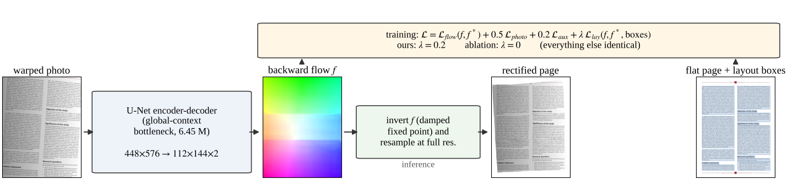
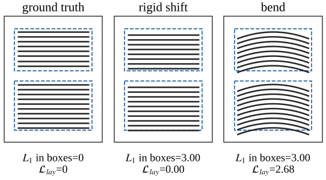

# Layout-Consistency Loss for Document Image Dewarping

Code, trained weights, results and the draft paper for
**"Layout-Consistency Loss: Free Geometric Supervision for Document Image Dewarping"**
([paper/main.pdf](paper/main.pdf)).

Photos of paper documents are bent, tilted and creased. A dewarping model maps
such a photo back to a flat page. This project trains a small U-Net that predicts
a dense **backward flow field** for that mapping. On top of the usual flow loss, it
adds a **layout-consistency loss**: inside every text region of the page, the
flow error must not *bend*.



## The idea in one paragraph

Two predictions can have the same average flow error and still look completely
different. If a whole text block is shifted by 3 px, the text is still straight
and readable. If the block's lines are bowed by 3 px in the middle, the text
curves and OCR suffers. An ordinary L1 flow loss cannot tell these apart. Layout
datasets such as [PubLayNet](https://github.com/ibm-aur-nlp/PubLayNet) already
give a box for every text, title and list region, and in a correctly flattened
page every such region is an axis-aligned rectangle. The loss therefore splits
the flat page into horizontal and vertical bands and penalizes the **variance of
the flow error inside each band, only over pixels inside text regions**.

- A rigid shift costs nothing.
- A bend costs a lot.
- The region boxes come for free when the training warps are synthesized from a
  layout dataset.



## Main results

Everything below compares two training runs that differ **only** in the weight
λ of the layout loss: ours with λ = 0.2, the ablation with λ = 0. Both use the
same data, seed, schedule and architecture, and both trained for 30 epochs
(531,990 steps). Reductions are (ablation − ours) / ablation.

**Synthetic validation set** (2,737 samples): straighter text at no cost in
average error.

| | EPE (px) ↓ | layout distortion 𝒞 ↓ |
|---|---|---|
| identity (no dewarping) | 39.88 | – |
| ablation (λ = 0) | 3.689 | 0.4714 |
| **ours (λ = 0.2)** | **3.662** | **0.4398** |
| reduction | 0.7 % | **6.7 %** |

The paired comparison on 334 pages gives:

- **𝒞:** 6.1 % lower, 95 % CI [4.1, 8.2] %, p = 1.5·10⁻⁹. The horizontal part drops 8.3 %.
- **EPE:** the difference is not significant (p = 0.59).

**OCR on 332 synthetic pages** (Tesseract, character error rate):

| | mean CER | on the hardest ("combined") warps |
|---|---|---|
| input | 63.05 % | 77.01 % |
| ablation | 30.37 % | 34.47 % |
| **ours** | **28.61 %** | **29.78 %** |
| true flow (upper bound) | 13.70 % | 18.19 % |

The overall improvement has p = 4.6·10⁻⁶ (ours is better on 203 pages and worse
on 126). On combined warps CER is 13.6 % lower.

**Real photos ([DocUNet benchmark](http://vision.cs.stonybrook.edu/~kema/docwarp/),
130 phone photos):**

- Both models clearly improve on the raw photos.
- The two models are statistically indistinguishable on real photos.
- Both are far behind state-of-the-art methods trained on 3D-rendered or real data.

| | MS-SSIM ↑ | LD ↓ | CER (60 img) ↓ |
|---|---|---|---|
| distorted photos | 0.249 | 20.52 | 0.509 |
| ablation | 0.322 | 16.85 | 0.390 |
| ours | 0.324 | 16.98 | 0.363 |
| DocTr (published, for scale) | 0.511 | 7.76 | 0.175 |

Our evaluation pipeline reproduces the published score of the raw photos (ours 0.249 / 20.52 / 0.509,
published 0.246 / 20.51 / 0.509), so the comparison is like-for-like.

Every number, with its source file, is listed in [docs/RESULTS.md](docs/RESULTS.md).
The limitations, most importantly **one training seed per arm**, are in the paper
and in [docs/NEXT_STEPS.md](docs/NEXT_STEPS.md).

## Try it in one minute

```bash
pip install -r requirements.txt
python training/inference.py --ckpt weights/dewarpnet_layout_lambda0.2.pt \
    --image examples/synthetic_cylinder_PMC6091653_00001.jpg --out fixed.png --device cpu
# -> fixed.png and fixed_sidebyside.png
```

It works on any photo of a document, at any resolution. The network sees a
448×576 copy, and the predicted flow is applied to the full-resolution image.
Expect much better results on pages that look like the training data (printed
articles, moderate curl) than on crumpled paper; see the paper.

## What is in this repository

```
augmentation/   synthetic data: warps, dataset builder, layout store, the layout loss, tests
training/       model, losses, dataset loader, train.py, inference, evaluation (EPE, 𝒞, OCR)
notebooks/      Kaggle notebook that ran both training arms (all modes in one notebook)
evaluation/     DocUNet real-photo benchmark (Octave port of the official eval + Tesseract 5.0.1)
weights/        the two trained models (26 MB each, weights only)
results/        every result file behind the paper, training logs, dataset build reports
paper/          LaTeX source, PDF, bibliography, figures and the scripts that draw them
examples/       two synthetic test photos
tools/          Kaggle upload staging, dataset inspection
docs/           how to reproduce, method notes, code guide, results, next steps, history
```

## Where to go next

| I want to… | read |
|---|---|
| understand the method and its conventions (flow direction, units, grids) | [docs/METHOD.md](docs/METHOD.md) |
| find my way around the code | [docs/CODE_GUIDE.md](docs/CODE_GUIDE.md) |
| reproduce everything, from PubLayNet to the paper's figures | [docs/REPRODUCE.md](docs/REPRODUCE.md) |
| train on Kaggle (both arms, multi-session resume) | [docs/KAGGLE_GUIDE.md](docs/KAGGLE_GUIDE.md) |
| evaluate on real photos | [evaluation/docunet/README.md](evaluation/docunet/README.md) |
| see every number and where it came from | [docs/RESULTS.md](docs/RESULTS.md) |
| continue the research | [docs/NEXT_STEPS.md](docs/NEXT_STEPS.md) |
| know what was tried, what broke and why decisions were made | [docs/HISTORY.md](docs/HISTORY.md) |

## Requirements

- Python 3.10 or newer, and the packages in `requirements.txt`.
- **Training:** one GPU with 16 GB, e.g. a free Kaggle T4. One arm took 16–18
  GPU-hours in two sessions (ours: 11.0 h + 6.6 h; ablation: 10.0 h + 6.1 h).
- **Building the dataset:** the PubLayNet images and `train.json`. The built
  dataset is about 25 GB.
- **DocUNet evaluation:** GNU Octave with the `image` package, and Tesseract
  5.0.1 (a build script is included).

## What is not included

- **PubLayNet pages and the built training dataset (about 25 GB).** Rebuild them
  with the scripts; the exact page list is in `results/dataset_build/source_pages.txt.gz`.
  The Kaggle copies used for training are private.
- **The DocUNet benchmark and its evaluation code.** Download them from the
  benchmark page; `evaluation/docunet/` patches the code to run in Octave.
- **Intermediate checkpoints with optimizer state.** Only the two final
  models are included, as weights.

## Status

This is a research prototype with a draft paper. The synthetic-data results are
complete and statistically tested. The real-photo gap is the main open problem;
see [docs/NEXT_STEPS.md](docs/NEXT_STEPS.md).

## Acknowledgements and data

- [PubLayNet](https://github.com/ibm-aur-nlp/PubLayNet) (Zhong et al., ICDAR 2019),
  distributed under CDLA-Permissive-1.0. It provides the source pages and layout
  boxes.
- [DocUNet benchmark](http://vision.cs.stonybrook.edu/~kema/docwarp/) (Ma et al.,
  CVPR 2018) and its evaluation code. Neither is redistributed here.
- The DocTr / DocGeoNet / DocScanner authors released their evaluation scripts
  and per-setting OCR lists; we follow them exactly.
- Training ran on free Kaggle GPUs.

The code and weights are released under the MIT license (see [LICENSE](LICENSE));
the weights were trained on data derived from PubLayNet (CDLA-Permissive-1.0).
